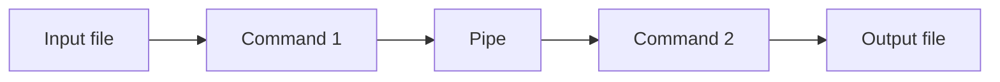

# Pipex

Pipex is a 42 school project written in C. It reproduces a simple shell pipeline that connects two commands, with input and output redirection:

```text
< input_file command1 | command2 > output_file
```

The project explores process creation (`fork`), pipes (`pipe`), file descriptor redirection (`dup2`), and command execution (`execve`).

## Features

- Runs two commands in sequence, passing the first command's output to the second command.
- Reads input from a file and creates or truncates the output file.
- Searches for executables in the directories listed in the `PATH` environment variable.
- Also accepts command paths that contain `/`.
- Waits for the child processes and returns the last command's exit status.

## Requirements

- A Unix-like environment with the system calls used by the project.
- `make` and a C compiler available as `cc`.

The `pedro_lib` library used by the project is included in the repository.

## Build

From the repository root, run:

```sh
make
```

This builds the `pipex` executable in the repository root. The following cleanup targets are also available:

```sh
make clean   # remove object files
make fclean  # also remove the executable and compiled library
make re      # clean and rebuild
```

## Usage

```sh
./pipex input_file "command1 with arguments" "command2 with arguments" output_file
```

For example:

```sh
./pipex input.txt "grep 42" "wc -l" output.txt
```

This is equivalent to the following shell operation:

```sh
< input.txt grep 42 | wc -l > output.txt
```

The program expects exactly four arguments after `./pipex`: the input file, the first command, the second command, and the output file.

## How it works

1. The parent process creates a pipe and forks a child process for each command.
2. The first child redirects its input from the input file and its output to the pipe.
3. The second child reads from the pipe and redirects its output to the output file.
4. Each child locates and executes its command; the parent waits for the children to finish.



## Code structure

- `srcs_mandatory/pipex.c`: validates the argument count, initializes the program, and coordinates the processes.
- `srcs_mandatory/init_struct.c`: stores the commands, file names, and environment in the project structure.
- `srcs_mandatory/child_process.c` and `srcs_mandatory/redirector.c`: configure child processes and their redirections.
- `srcs_mandatory/file_opener.c`: opens the input and output files.
- `srcs_mandatory/cmd_exec.c`, `srcs_mandatory/cmd_path.c`, and `srcs_mandatory/find_env.c`: split, locate, and execute commands.
- `srcs_mandatory/wait_da_boy.c`: waits for the processes and retrieves the final status.
- `Includes/pipex.h`: defines the project structure and function prototypes.
- `Libraries/pedro_lib/`: bundled C library, used primarily for string utilities.

## Limitations

Pipex does not parse commands like a full shell. It splits each command on spaces, so quoting within a command, variable expansion, wildcards, and shell operators are not interpreted by Pipex. Quotes in the example are handled by the calling shell to pass each command as a single argument.

This repository contains the mandatory two-command implementation; the bonus implementation is not included.
